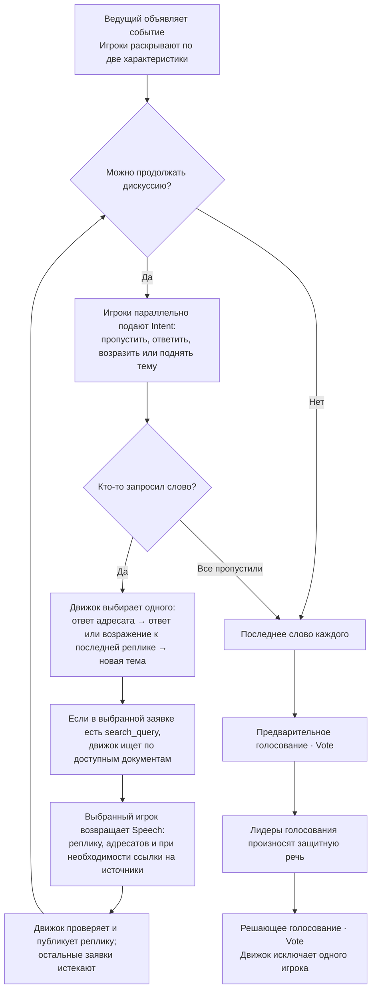

# Бункер · Агентский театр

**Копылов Михаил Юрьевич, М8О-206СВ-25**

[Посмотреть партию на Render](https://bunker-theatre-cwc.onrender.com)

[Ноутбук](LLM_Theatre.ipynb) · [Отчёт](REPORT.md) · [Локальный запуск](docs/RUN.md)

## Как взаимодействуют агенты

При равном приоритете слово получает тот, кто говорил реже; затем решает
вращающийся порядок мест. Предыдущий выступающий пропускает такт. Дискуссия
ограничена двумя репликами на игрока, восемью на раунд и десятью минутами
активного времени.

[Действия и инструменты агентов](docs/architecture/LLM_TOOLS.md) · [Подробная схема взаимодействия](docs/architecture/interaction.html)
